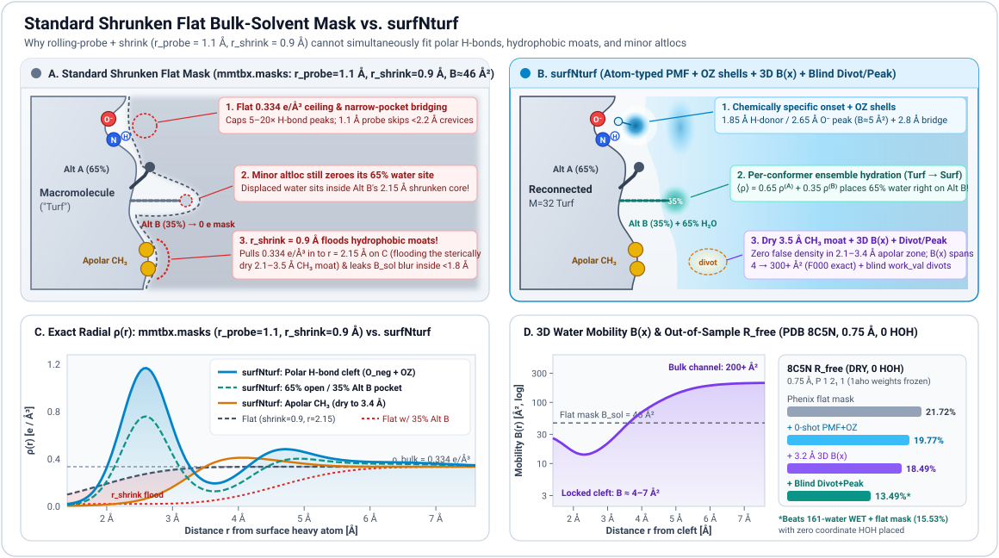

# surfNturf

**Differentiable multi-conformer crystal hydration (*Surf*), conformer reconnection (*Turf*), 3D water mobility $B(\mathbf{x})$, chemical-state feedback, amphiphilic micelle modelling, and X-ray bulk-solvent structure factors.**

The classic shrunken continuum bulk-solvent mask (`r_probe`, `r_shrink`, and resolution-dependent `k_mask(s)` / `B_sol`; Jiang & Brünger 1994; Fokine & Urzhumtsev 2002; Afonine et al. 2005, 2013) has been a cornerstone of macromolecular crystallography for over three decades—capturing low-angle solvent scattering robustly with minimal parameters via a single compromise boundary (`r_vdW + r_probe - r_shrink ≈ r_vdW + 0.2 Å`). Between `~4 Å` and atomic resolution, however, crystal solvent exhibits rich local structure beyond a uniform continuum: polar donors and acceptors organize sharp first and second hydration shells, hydrophobic groups create wider (`~3.4 Å`) van der Waals depletion zones, alternate macromolecular conformers (*Turf*) share pockets with partial-occupancy water (*Surf*), mother-liquor cosolvents and detergent micelles shift solvent electron density away from pure water, and water mobility $B(\mathbf{x})$ spans two orders of magnitude from tethered clefts to open channels.

Building directly on `phenix.refine`'s user-supplied `FPART / PHIPART` solvent framework, **surfNturf** extends the continuum mask with a fast, analytically differentiable, space-group-exact hydration and solvent architecture trained once on explicit-water crystal MD and transferable in seconds to any single-conformer, multi-altloc, or multi-model crystal structure — with **zero MD simulation required at application time**.



---

## Physical Architecture (*Surf* & *Turf*)

Given any crystallographic structure (single-conformer, `A/B`, heterogeneous multi-altloc PDB/mmCIF, or a directory of `m*.pdb` conformers from an external linear-programming untangler such as Passmore's `Untangler`), **surfNturf** evaluates seven physically coupled layers on the exact crystal Asymmetric Unit (`ASUGrid`):

1. **Conformer Completion — *Turf* (`surfnturf.reconnect` or external `m*.pdb` ensembles):**
   Accepts pre-untangled conformer directories (`m01.pdb .. mNN.pdb`) directly, or expands heterogeneous multi-altloc PDB/mmCIF files on the fly into $M$ (default `32`) sterically compatible complete conformers via a fast Kuhn–Munkres Hungarian + interval-cut heuristic (`surfnturf reconnect`), filtering riding-H ghost altlocs, preserving DNA/disulfide/metal/glycan bonds, and re-bisecting cross-letter amide `H/D` atoms.
2. **10-Class Protonation-Aware Solute–Water PMF + Explicit $sp^2 / sp^3$ Lone Pairs (`182` spline parameters; optional `+Epol`):**
   Separates explicit polar donor hydrogens (`H_pol` at `1.85 Å`, cationic `H_pos` at `1.78 Å`), nonpolar `C–H` (`H_apol`), anionic carboxylate/coordinating ions (`O_neg`), carbonyl (`O_carb`), hydroxyl/ether/aromatic-acceptor (`O_hyd`), donor `N` / large polar ions (`N_don`), `C_sp2` / `P`, `C_sp3`, and `S_sul` / `Se`—augmented with explicit lone-pair virtual sites at $d_{\text{LP}} = 0.65\text{ \AA}$ (`LP_sp2` at $120^\circ$ on `C=O` / aromatic `N`, `LP_neg` on `COO-`, and tetrahedral `LP_sp3` at $109.47^\circ$ on `OH` and `C–O–C` / `P–O–C` bridges) using $C^2$ cardinal cubic B-splines on `[1.40, 5.60 Å]`. Screened AMBER-charge crystal electric-field polarization (`+Epol`, `3` parameters) is also included and off by default (`surfnturf train --epol`).
3. **Grand-Canonical Langmuir Saturation (`1` parameter) + Rosenfeld 0D Cavity Cap (`0` parameters):**
   $$g_1^{(m)}(\mathbf{x}) = \frac{1}{\alpha}\,\sigma\!\left(\ln\frac{\alpha}{1-\alpha} - U_0^{(m)}(\mathbf{x})\right)$$
   Multi-tethered groove waters cooperate multiplicatively while a parameter-free Rosenfeld 0D exclusion cavity cap ($r_{\text{cav}} = 1.30\text{ \AA}$, diameter $2.60\text{ \AA} < d_{\text{OO},\min}$) enforces $\le 1$ water molecule (`~10 e`) per exclusion sphere.
4. **4-Step Tetrahedral ($109.47^\circ$) Ornstein–Zernike Network Closure (`9` parameters) & Acceptor Water-H Polarization (`27` parameters):**
   Iterates $K = 4$ damped self-consistent steps combining 5 radial Gaussian shells (`1.25..4.50 Å`) with exact spherical-harmonic ($l = 0, 1, 2$) Stillinger–Weber / mW 3-body tetrahedral coordination on the `2.80 Å` H-bond shell (with exact analytical empty-bulk offset subtraction so $\bar{g}_O(\infty) \equiv 1.000$), resolving 1- and 2-tethered ordered waters alongside a strictly zero-net-charge (`f_H(0) = 0`) acceptor-directed water-hydrogen polarization term.
5. **Exact `IT92` `(O + 2H)` Fourier Rendering, 3D Mobility $B(\mathbf{x})$, and Sparse `PeakDict` / `WatershedDivotDict`:**
   * Renders molecular water number density into electron density (`e/ų`) with International Tables `IT92` oxygen + orientational `2H` (`r_OH = 0.9572 Å`) form factors, conserving `F000` identically.
   * **`surfnturf.bmob`**: Renders spatially varying water mobility $B(\mathbf{x}) \in [0.625, 2560]\text{ \AA}^2$ via a `13`-level Catmull–Rom partition-of-unity basis on $\ln B$, refined against `90% work_train` $|F_{\text{obs}}|$ under strict pure-water `--kmask-mode fixed_one` ($k_{\text{mask}} \equiv 1$, default, eliminating gauge collinearity between $B(\mathbf{x})$ and per-shell $k_{\text{mask}}(s)$) or `--kmask-mode global_scalar` ($k_{\text{bulk}} = \rho_{\text{mother}} / \rho_{\text{water}} \in [0.65, 1.50]$ for non-water mother liquors).
   * **`surfnturf.divot`**: Captures crystal-specific interstitial cavities, cryoprotectant/ion pockets, and sub-voxel hydration peaks from exact `e/ų` work-set `mFo - DFc` maps via continuous-coordinate `IT92` peaks (`ContinuousPeakDict`), Bader steepest-ascent basins (`WatershedDivotDict`), or wall-clamped mass-conserving transport (`W_mc`), locking `--k-solv-mode fixed_one` with exact zero-leak protein-core masking and strict blind hyperparameter selection on unseen `5% work_val` (`5% R-free` untouched).
6. **Differentiable Chemical Feedback (`surfnturf.chemfit` / `surfnturf fit-chem`):**
   Adapts 6 physical mother-liquor environment knobs (`anionic_well`, `neutral_acc_well`, `donor_well`, `apolar_contrast`, `pocket_activity`, `network_coop`) alongside continuous soft-Boltzmann posteriors over discrete chemical/tautomer/rotamer states (`ASN/GLN` $180^\circ$ flips, `HIS` `HID/HIE/HIP+`, `ASP/GLU` `COO-/COOH`, and `SER/THR/TYR` `-OH` rotamers) via sparse `ASU` feature deltas + analytical `IT92` $\Delta F_{\text{calc}}(\mathbf{h})$, fitted strictly on `90% work_train` and gated on unseen `5% work_val` (`5% R-free` never read).
7. **Amphiphilic Detergent Micelle / Lipid-Belt Model (`surfnturf.micelle` / `surfnturf fit-micelle`):**
   Automatically detects transmembrane hydrophobic belts and 12-sector azimuthal central aqueous pores (`detect_transmembrane_belt`) from coordinates alone, carving a smooth $C^\infty$ 3-zone partition of unity (low-density aliphatic tail core + high-density polar headgroup collar + structured aqueous `surfNturf` inside central pores and crystal channels) gated against a `1`-scalar `aqueous_blur` baseline on unseen `5% work_val`.

Every layer has **exact hand-derived analytical reverse-mode adjoints** (BLAS `DGEMV` + real `rfftn`/`irfftn` Parseval 3D FFTs, verified against central finite differences to `1e-10`–`1e-6` across float64 layers and `< 2e-4` with float32 BLAS feature caching). For full mathematical derivations of all layers, see [PHYSICAL_PRINCIPLES.md](PHYSICAL_PRINCIPLES.md).

---

## Installation

`surfNturf` requires Python `>= 3.9` with `numpy`, `scipy`, and `gemmi` (all pre-installed in modern Phenix `2.x` and CCP4 `9` Python environments):

```bash
git clone https://github.com/jmholton/surfNturf.git
cd surfNturf
pip install -e .
```

On read-only synchrotron/cluster installations (`phenix.python` or `ccp4-python`), `surfNturf` also runs **directly from the git checkout without `pip install`**:

```bash
phenix.python -m surfnturf --help
phenix.python -m surfnturf test
```

---

## Quickstart

### 1. Zero-MD Hydration Maps & `FPART/PHIPART` Structure Factors
Predict de-blurred water oxygen relative probability (`_want.ccp4`), steric exclusion (`_cannot.ccp4` in `[0, 1]`), rendered total solvent density (`_solvent.ccp4` in `e/ų`), ordered-water-displaced bulk solvent (`_bulk.ccp4`), and reciprocal-space `FPART/PHIPART` structure factors (`_fpart.mtz`):

```bash
# Onto the exact Miller indices of an experimental diffraction MTZ:
surfnturf predict model.pdb out/solv --hkl refme.mtz

# Or from a directory of Untangler / ensemble member PDBs (m01.pdb .. m32.pdb):
surfnturf predict untangled_members/ out/solv --hkl refme.mtz

# Or directly via phenix.python without pip install:
phenix.python -m surfnturf predict model.pdb out/solv hkl=refme.mtz B=5.0

# Dry prediction (ignoring any existing HOH records in model.pdb):
surfnturf predict model.pdb out/solv_dry --hkl refme.mtz --ignore-waters

# With zero-shot 6-parameter physical 3D mobility B(x):
surfnturf predict model.pdb out/solv_phys --hkl refme.mtz --bmob dry_a4 --ignore-waters
```

Use the resulting `out/solv_fpart.mtz` in `phenix.refine` (user bulk-solvent build):

```bash
phenix.refine model.pdb refme.mtz \
  refinement.input.bulk_solvent_map.file_name=out/solv_fpart.mtz \
  refinement.input.bulk_solvent_map.amplitudes_label=FPART \
  refinement.input.bulk_solvent_map.phases_label=PHIPART
```

### 2. Heuristic Multi-Altloc Conformer Reconnection (`surfnturf reconnect`)
Expand a heterogeneous multi-altloc PDB/mmCIF into `32` clash-free reconnected conformer PDBs (`m01.pdb .. m32.pdb`):

```bash
surfnturf reconnect model_multialt.pdb out/members --nconf 32
```

### 3. Work-Set X-Ray Mobility $B(\mathbf{x})$ & Sparse Peak/Divot Refinement
First export a 0-cycle `*_f_model.mtz` from `phenix.refine` with `output.export_final_f_model=True` (providing `FOBS`, `R_FREE_FLAGS`, `FCALC`, `PHIFCALC`, `FMASK`, `PHIFMASK`, `FMODEL`, `PHIFMODEL`, `K_MASK`, and `K_ISOTROPIC`/`K_ANISOTROPIC`). All X-ray fitting commands (`fit-bmob`, `fit-divot`, `fit-chem`, `fit-micelle`) share a deterministic symmetry-invariant `90% work_train / 5% work_val / 5% R-free` split (supporting `0..19` CCP4, `0/1`, SHELX `-1/1`, or `--free-flag-value`), automatically complete missing riding hydrogens across protein & nucleic-acid PDBs, scale spatial `B(x)` smoothing with resolution (`--fwhm auto` $\to 3.2\text{ \AA}$ for $d_{\min} \le 1.0\text{ \AA}$, $\max(3.2\text{ \AA}, 3.5\,d_{\min})$ at lower resolution), and gate stage complexity strictly on unseen `5% work_val` (the R-free test set is never touched):

```bash
# Blind work_val-gated 3D water mobility B(x) on 90% work_train |Fo| (default --mode auto, strict pure-water k_mask = 1):
surfnturf fit-bmob --pdb model.pdb --fmodel-mtz score_001_f_model.mtz --data-mtz refme.mtz --out out/bmob

# For high-salt / PEG / cryoprotectant mother liquors (floating k_bulk on work_train + optional input-FMASK fallback):
surfnturf fit-bmob --pdb model.pdb --fmodel-mtz score_001_f_model.mtz --data-mtz refme.mtz --out out/bmob_ml --kmask-mode global_scalar --fallback-fmodel

# Or joint 3D water mobility B(x) + PMF refinement on work_train |Fo|:
surfnturf fit-bmob --pdb model.pdb --fmodel-mtz score_001_f_model.mtz --data-mtz refme.mtz --out out/bmob_joint --mode joint

# Blind work_val-gated sparse PeakDict + WatershedDivotDict refinement (k_solv = 1, protein core masked, R-free untouched):
surfnturf fit-divot --pdb model.pdb --fmodel-mtz score_001_f_model.mtz --data-mtz refme.mtz --base-ccp4 out/bmob_solvent.ccp4 --out out/hybrid --arm hybrid
```

### 4. Differentiable Chemical Feedback & Amphiphilic Detergent Micelles
```bash
# Blind work_val-gated mother-liquor adaptation + ASN/GLN flip, HIS tautomer, ASP/GLU protonation & -OH rotamer inference:
surfnturf fit-chem --pdb model.pdb --fmodel-mtz score_001_f_model.mtz --data-mtz refme.mtz --out out/chem --out-pdb out/model_chem.pdb

# Blind work_val-gated transmembrane detergent-micelle / lipid-belt model (preserves aqueous central pores; auto-skips soluble proteins):
surfnturf fit-micelle --pdb membrane_model.pdb --fmodel-mtz score_001_f_model.mtz --data-mtz refme.mtz --out out/micelle
```

### 5. Python API

```python
import surfnturf

cell, sg, grid, members, want_3d, cannot_3d, solv_3d = surfnturf.predict_maps_for_target(
    "model.pdb", weights="l2", B_map=5.0, grid_spacing=0.45, nconf=32
)
surfnturf.write_ccp4("solvent.ccp4", solv_3d, cell, sg)
surfnturf.write_fpart_mtz_to_dmin(solv_3d, cell, sg, dmin=1.0, out_mtz_path="solvent_fpart.mtz")
```

---

## Benchmarks

All v0.2 numbers below use the default 219-parameter `l2` weights (`pmf_full_l2.npz`, `Epol` off; legacy 173-parameter v0.1 weights remain bundled as `--weights v1_l2` / `v1_kl`):

1. **Zero-shot MD hydration & ordered-water stoichiometry (`1aho` 32-conformer explicit-water AMBER MD & `1AHO.pdb` `129` deposited waters):**
   * Cross-trajectory 10-class hydration correlation increases from `CC = 0.72` (2-type `N/O` vs `C/S` Gaussian baseline) to **`CC = 0.875–0.881`** across all 4 trajectories (`RMSE = 0.068–0.095 e/ų`), outperforming periodic 32-conformer `AMBER22 3D-RISM KH` (`< 3 Å` shell `CCv = +0.70` vs `-0.16`), with exact empty-cell asymptote $\bar{g}_O(\infty) = 1.000000000$.
   * Adding explicit lone pairs + 4-step tetrahedral closure + Rosenfeld 0D cavity cap (`v0.2 l2` vs `v1_l2`) doubles 1-tethered ordered-water peak density (`HOH 113` on `Gly34 O`: `1.08 → 2.28 e/ų`; `25` `1-HB` waters median `1.22 → 2.20 e/ų`, integrated `5.5 → 7.5 e`) while holding 3-tethered `HOH 108` to physical 1-water stoichiometry (`8.8 e`, `B_pocket = 5.1 Ų`).
2. **Ground-truth synthetic diffraction benchmark (`1aho`, `v1_l2` base, R-free test set untouched):**
   * Zero-MD `surfNturf` + `3.2 Å B(x)` + `Hybrid (Divot + PeakDict)` reaches **`R_true_free = 7.12%`** (`E_solv = 0.336`), matching a 50 ns explicit-water MD start + `Hybrid` (`7.09%`, `E_solv = 0.332`).
   * Over 30 macrocycles of `phenix.refine`, zero-MD `surfNturf` + `PeakDict` achieves `R_work / R_free = 7.03% / 8.91%`, `R_true_free = 8.45%`, and heavy-atom `RMSD = 0.0606 Å` (`max 0.337 Å`), outperforming 50 ns MD + Fourier shift-and-scale (`7.84% / 10.44%`, `R_true_free = 10.16%`).
3. **Real `1aho` experimental diffraction (`0.96 Å`, `P 21 21 21`, `0`-cycle `phenix.refine` common ruler on `1aho_best_so_far_trimmed.pdb`, `0` MD, v0.2 `l2`):**
   * **`DRY` (`0` coordinate waters):** `17.22% / 17.93%` (Phenix flat mask) → **`13.01% / 13.98%`** (0-shot `surfNturf` `B = 5 Ų`; `v1_l2`: `13.26% / 14.19%`) → **`11.84% / 13.32%`** (`fit-bmob --mode auto`, strict `k_mask = 1`) or **`10.75% / 12.36%`** (`--mode joint`) → **`9.44% / 11.56%`** (`+ fit-divot --arm hybrid`, strict `k_solv = 1` + core-masked `90/5/5` blind `work_val` gate; **`9.24% / 11.40%`** with `--kmask-mode global_scalar`).
   * **`WET` (ordered waters displaced):** `14.35% / 15.35%` (Phenix flat mask) → **`11.58% / 12.87%`** (0-shot `surfNturf` `B = 5 Ų`) → **`10.95% / 12.36%`** (`fit-bmob --mode auto`, strict `k_mask = 1`).
4. **Cross-protein, cross-space-group, sub-atomic generalization on `8C5N` (`0.75 Å`, monoclinic `P 1 21 1`, $\beta = 99.25^\circ$, `186` residues, `198,461` reflections, `9,968` R-free test reflections untouched; `1aho` MD weights frozen, v0.2 `l2`):**
   * **Zero-shot water-site recall (`161` experimental `0.75 Å` waters):** `98.8%` sterically allowed (`cannot < 0.2`), **`95.7%` at `want > 1.2`** (`92.5%` at `want > 1.5`), with **median $g_O = 7.66\times$** (`10.18×` on H-completed `8C5N`; up from `5.28×` in `v1_l2`).
   * **`DRY` (`0` coordinate `HOH` in PDB):** `21.22% / 21.72%` (Phenix flat mask) → **`19.09% / 19.57%`** (0-shot `surfNturf` directly from H-less `8c5n_dry.pdb` via built-in riding-H completion; `v1_l2`: `19.47% / 19.88%`) → **`17.49% / 18.40%`** (`fit-bmob --mode auto`, `k_mask = 1`) → **`13.00% / 14.42%`** (`+ fit-divot --arm hybrid`, strict `k_solv = 1` + exact zero-leak protein core), **beating the deposited `161`-water `WET` model + flat mask (`14.60% / 15.53%`) by `-1.11%` `R_free` with zero coordinate waters**.
   * **`WET` (`161` deposited `HOH` + `CL` + `ANISOU` untouched):** `15.40% / 16.30%` (PDB header) → `14.60% / 15.53%` (Phenix flat mask) → **`14.06% / 15.00%`** (0-shot `surfNturf`) → **`13.28% / 14.34%`** (`fit-bmob --mode auto`, `k_mask = 1`) → **`11.32% / 12.76%`** (`+ fit-divot --arm hybrid`, **`-2.77%` overall `R_free` vs Phenix flat mask**).
5. **Blind chemical feedback (`fit-chem`) & amphiphilic micelle modelling (`fit-micelle`) (`5% R-free` untouched):**
   * **`fit-chem` across `2.70 Å`–`0.75 Å` experimental data:** On room-temperature `3QUE` (`2.70 Å`, `PEG 4000 + 50 mM BOG`), blind `work_val` rejects per-site degrees of freedom and selects `stage = env`, improving `0`-cycle `DRY` `R_work / R_free` from `22.12% / 29.17%` to **`21.77% / 28.83%`** (`WET`: `21.70% / 29.18%` → **`21.47% / 28.92%`**). On `1aho` (`0.96 Å`, `MPD + CaCl2`), `DRY` `stage = env` improves `12.93% / 13.95%` → **`12.73% / 13.77%`** (`> 5 Å` `R_free` `-1.01%`) while `WET` gates cleanly to `base`. On sub-atomic `8C5N` (`0.75 Å`), `work_val` selects `stage = joint` (`18.59%` → **`18.36%`** `R_free`), identifying `13` high-posterior chemical states (`GLN62` $180^\circ$ flip, `HIS186` `HID → HIE`, protonated `ASP196` `COOH`, and `10` `-OH` rotamers).
   * **`fit-micelle` specificity & transmembrane $\beta$-barrel recovery:** `detect_transmembrane_belt` rejects soluble crystals from coordinates alone (`1aho`, `8C5N`, and cytosolic p38 $\alpha$ kinase `3QUE` co-crystallized with `50 mM BOG` additive), and `work_val` + `aqueous_blur` gates non-micelle transmembrane helix `9ARN` (HIV-1 gp41 in `Li2SO4 + PEG-1500`) to `aqueous_gated` (`0` false-positive micelle overfitting). On an `88`-residue transmembrane $\beta$-barrel in a BOG-like detergent belt (`1.80 Å`, `5% R-free` untouched), `fit-micelle` drops `0`-cycle `Phenix` `R_work / R_free` from `17.81% / 17.03%` (flat mask) and `7.86% / 7.89%` (aqueous `fit-bmob`) to **`4.14% / 4.09%`**, recovering $\rho_{\text{tail}} = 0.264\text{ e/\AA}^3$ and $\rho_{\text{head}} = 0.404\text{ e/\AA}^3$ while preserving structured water inside the central polar lumen.

---

## Verification Suite

Run all `41` analytical vs. central finite-difference gradient, symmetry, blindness, and zero-`R-free`-leakage checks:

```bash
surfnturf test
# or:
pytest
```

## License

MIT License — Copyright (c) 2026 James Holton. See [LICENSE](LICENSE).
